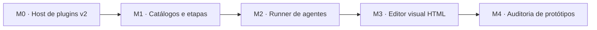

# Plano integrado — plugins e protótipos M0–M4

Base: pré-release [`v0.1.0-alpha.1`](https://github.com/odoisbr/dk-terminal/releases/tag/v0.1.0-alpha.1), commit `f8106c8bbd9a0230b01b86a22786f134f82834ca`. Esta branch prepara a execução; **nenhum marco é declarado implementado ou aprovado por este planejamento**.

O plano consolida a análise independente de host e catálogos, agentes e editor visual, e auditoria e qualidade. Preserva o [plano original](../plano-plugins-projeto.md), a [orquestração](../orquestracao-plugins-projeto.md), os contratos e os resultados históricos copiados para esta branch. Os resultados do M0 anterior são insumos de análise: a coordenação foi interrompida e não consta como concluída.

## Ordem e entregas

| Marco | Entrega demonstrável | Planejamento |
|---|---|---|
| M0 | Plugin por projeto, manifesto v2, permissões visíveis, recarga e preservação das extensões atuais. | [M0 e M1](01-m0-m1.md) |
| M1 | Catálogo e barra de etapas com critérios e procedência verificáveis. | [M0 e M1](01-m0-m1.md) |
| M2 | Execução de agente pela CLI oficial, streaming, aprovação explícita e cancelamento. | [M2 e M3](02-m2-m3.md) |
| M3 | Edição visual de HTML local, desfazer/refazer e salvamento protegido contra conflito. | [M2 e M3](02-m2-m3.md) |
| M4 | Auditoria rastreável de tela contra requisitos, com sugestões submetidas à revisão humana. | [M4 e qualidade](03-m4-qualidade.md) |

A ordem reflete a decisão registrada: **M2 antes de M3**. A referência do gerador e do contrato de M3 foi corrigida para apontar a M2. Porém, o critério atual de coordenação aceita um resultado declarado pelo executor: isso **não comprova sozinho o estado real do marco anterior**. Antes de despachar M3, é necessário verificar o estado e as evidências reais de M2; antes de M4, os de M2 e M3. A mesma limitação deve ser revista nos demais marcos. Testes de estrutura não substituem um gate determinístico.

Na versão `1.7.0-rc.2` do kit examinada, o critério `json_valor` lê arquivos de até 4 MiB; o estado histórico M0 nesta máquina ocupa aproximadamente 11 MiB. Não basta trocar o tipo do critério e presumir que conseguirá ler estados grandes: o desenho do gate precisa prever uma evidência compacta e verificável, limites de tamanho e testes de ausência, divergência e conclusão válida.

## Decisões preservadas e limites

- Plugins de terceiros são declarados em JSON e executados por processos filhos, não como JavaScript no renderer ou no main. Uma permissão declarada não constitui isolamento do sistema operacional: o processo roda com os direitos da conta do usuário.
- O Claude permanece na CLI oficial e na autenticação existente. O mecanismo de aprovação interativa para um runner automatizado ainda precisa ser provado; não usar bypass de permissões. Preservar o chat Codex existente, suas aprovações e histórico.
- O browser de serviço atual pode acessar recursos de rede. A política sem rede proposta é para a nova superfície de edição M3, que deve ter proteção e testes próprios.
- O projeto continua responsável por seus arquivos: nenhuma escrita automática, perda de histórico ou encerramento de tarefa ativa para atingir metas de recursos. Mudanças externas e alterações não salvas precisam ser protegidas.
- A pré-release não demonstrou redução consistente de RSS nem atingiu as metas iniciais de 200/350 MB. Cada marco deverá medir cenários comparáveis e declarar limitações em vez de supor ganhos.

## Trabalho antes de iniciar M0

1. Revisar o desenho histórico à luz da base da release; a coordenação anterior foi parada durante edições concorrentes e não deve ser retomada como concluída.
2. Resolver como verificar de forma confiável a conclusão dos marcos e como executar o retrato de escopo sem incluir milhares de arquivos ignorados como `dist/` e `release/`. A cópia isolada usada para testes deve ser comparada por inventário e hashes com a árvore candidata, incluindo alterações não commitadas e arquivos novos; testar também divergências e arquivos ausentes.
3. Validar as capacidades reais do host e os nomes de modelos disponíveis na sessão de execução. Os perfis históricos registram pedidos, não prova do modelo efetivamente usado.
4. Conferir a identidade da CLI do Design Kit antes de invocá-la: nesta máquina há outra ferramenta chamada `dk` no PATH. A disponibilidade de `etapas` também deve ser verificada na versão efetivamente conectada.
5. Revalidar hashes e contratos quando os arquivos que servem de contexto ou alvo mudarem. Não iniciar automaticamente agentes nem alterar permissões por ter produzido este planejamento.

## Critério de fechamento de cada marco

Entregas revisadas, testes existentes e novos passando, cenário desktop quando aplicável, segurança sem bloqueantes, comparação de recursos quando relevante e evidências rastreáveis. Recursos indisponíveis e plataformas não testadas ficam explícitos. A publicação de outra versão é uma decisão separada.

A relação entre a fonte principal pretendida no GitLab SEA e o fork no GitHub continua uma pendência operacional do plano original; criar esta pré-release no GitHub não altera automaticamente os remotos.
