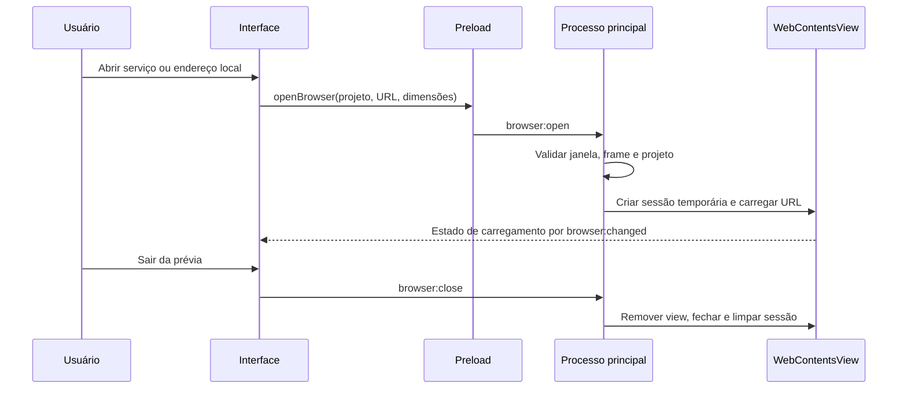

# 01 — Prévia e ciclo de vida

## Fonte observada

O IPC é admitido apenas do frame principal da janela em `dk-app://app/index.html` ([`electron/main.cjs`](../../electron/main.cjs#L95)); o projeto tem de estar entre os abertos ([`electron/main.cjs`](../../electron/main.cjs#L108)). O posicionamento acompanha a área da interface ([`src/main.ts`](../../src/main.ts#L514)).

| Superfície | Evidência na fonte | Limite |
|---|---|---|
| URL principal | [`localURL`](../../electron/browser.cjs#L3) e eventos de navegação/redirecionamento | HTTP(S), loopback e sem credenciais; não é filtro de todos os pedidos de rede. |
| View | [`electron/browser.cjs`](../../electron/browser.cjs#L31) | Sandbox, `contextIsolation`, `webSecurity`; sem Node, preload próprio ou `<webview>`. |
| Permissões e downloads | [`electron/browser.cjs`](../../electron/browser.cjs#L28) | Solicitações de permissão são negadas e downloads cancelados. |
| Armazenamento | [`electron/browser.cjs`](../../electron/browser.cjs#L16) | Partição em memória derivada do projeto; limpa ao sair da prévia. |
| HTML aberto no editor | [`src/editor.ts`](../../src/editor.ts#L285) | `iframe srcdoc` sem scripts, com CSP própria; é outra superfície, não a view do serviço. |

## Correções implementadas

Antes, a limpeza da sessão era iniciada sem ser aguardada: uma reabertura rápida da mesma partição podia ocorrer enquanto a limpeza anterior ainda estava pendente. A limpeza agora é coordenada por partição; se falhar, é tentada novamente antes de reabrir e, se continuar falhando, a reabertura é recusada com erro. Uma abertura antiga cancelada também deixa de alterar a nova view ou produzir erro obsoleto. Testes determinísticos reproduziram as duas condições na versão anterior e passaram com a correção.

Ao sair da área do browser ou trocar de projeto, a interface solicita o fechamento da view ([`src/main.ts`](../../src/main.ts#L434), [`src/main.ts`](../../src/main.ts#L665)). O serviço é gerenciado separadamente. No fechamento da janela, o processo principal também solicita o fechamento; a conclusão da limpeza assíncrona antes da saída total do processo não foi medida separadamente.
